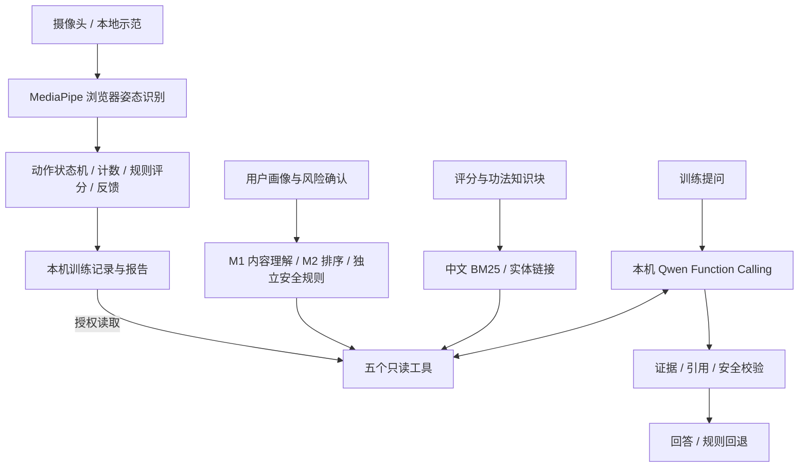

# FormPilot · 智能运动训练平台

FormPilot 面向居家规范运动与康复辅助场景，在浏览器中连接动作识别、实时反馈、训练报告、个性化推荐和 AI 训练问答。当前作品版本为 **Web V1.2.3**。本项目提供运动辅助，不作医疗诊断，没有临床疗效验证。

## 功能

| 模块 | 功能 |
| --- | --- |
| 动作训练 | 双臂上举、侧平举、侧步开合、徒手深蹲、交替提膝、肩部环绕；摄像头计数、实时纠错、语音提示、课程与自由训练 |
| 功法跟练 | 八段锦、太极拳、五禽戏、易筋经；章节选择、整套或单式跟练、姿态与节奏比较、分段报告 |
| 动作工坊 | 从摄像头或本地视频采集自己的动作，识别测试、保存、训练并查看报告 |
| 体感游戏 | 摘苹果、林间划船、林间射箭；共享姿态输入与完整游戏流程，游戏成绩独立于训练历史 |
| AI Coach | 画像与风险确认、M1/M2 训练推荐、推荐依据和固定五问；可选本机 Qwen 自由问答、只读工具调用和知识引用 |
| 记录与报告 | 本机训练历史、分段表现、问题分析、近期比较与训练趋势 |

摄像头画面在浏览器本地处理。训练记录保存在当前浏览器；AI Coach 读取记录需要用户单独授权。四套功法的视频和部分演示媒体需另行准备，具体见[素材与许可](docs/submission/ASSETS_AND_LICENSES.md)。

## 架构



平台采用 React 19、TypeScript、Vite 和 MediaPipe；独立游戏应用使用 React、Phaser 3 和 MediaPipe。团队实现训练流程、评分与报告、动作工坊、M1/M2 训练及浏览器推理、Agent 工具协议、检索、证据校验与回退。Qwen 负责理解提问、选择工具和组织解释，不参与摄像头识别或评分计算，没有进行微调。

Agent 使用 `search_knowledge`、`get_catalog`、`recommend_training`、`read_last_training`、`compare_recent_training` 五个只读工具，最多三轮、五次调用。RAG 使用中文 BM25 与实体链接，包含 220 个知识块，回答附 `[K#]` 引用；44 个出处仍待核验。实现使用 Function Calling，无 MCP Server 或向量检索。

M1 从参考轨迹的 1,677 个三秒窗口、76 个特征学习内容标签；M2 用 111 个特征在安全候选池内排序。发布 `fp-cdm-release/1.0.0` 的 M2 绑定 M1 v1.0 内容表，M1 v1.1 为保留的研究版本。M2 的 720 条标签来自单一 AI 标注者、72 个合成场景，属于实验性模型，尚无独立人工或专家验证。普通构建关闭模型，比赛构建启用实验性推荐；低适配、分布外或完整性错误时回退规则，风险门禁始终独立执行。

[模型报告](apps/platform/docs/ai-coach-agent/decision-model/MODEL_REPORT.md)、[训练复现](docs/submission/TRAINING_REPRODUCTION.md)和原始实验产物保留完整方法、对照、消融与负结果。历史 M2 冻结测试 NDCG@5 为 0.868，与规则差值的 95% CI 跨零，不能据此宣称显著优于规则或具有真实用户疗效。

## 安装与运行

源码环境：Node.js **22.18+**（CI 使用 24）、pnpm **12.5.1**、Edge 或 Chrome。Python **3.12** 仅用于素材恢复、离线封包或研究复现。摄像头需要浏览器授权与 `localhost` / `127.0.0.1` 安全上下文。

从仓库根目录分别安装两个应用：

```powershell
pnpm --dir apps/platform install --frozen-lockfile
pnpm --dir apps/motion-games-lab/app install --frozen-lockfile
```

游戏终端：

```powershell
cd apps/motion-games-lab/app
pnpm build
pnpm preview
```

平台终端：

```powershell
cd apps/platform
$env:VITE_MOTION_GAMES_URL = 'http://localhost:5181/'
pnpm competition:build
pnpm competition:preview
```

打开 **http://localhost:4175/**；游戏服务为 **http://localhost:5181/**，三款游戏共用该服务。保持两个终端运行。开发启动、端口配置、Windows 离线包、媒体恢复和重建步骤见[运行说明](docs/submission/RUNNING.md)。

无需大模型即可使用训练、功法跟练、动作工坊、报告、游戏、固定五问和 M1/M2 推荐。自由问答另需 **Ollama 0.40.13** 与 `qwen3:4b-instruct-2507-q4_K_M`，模型 digest 为 `0edcdef34593eac1aa2be9c7d06c432dcf81945adca5eca2f27662c18f168ba0`；模型约 2.5 GB，不随源码提供。安装、Bridge 启动与授权步骤见[运行说明](docs/submission/RUNNING.md)。未连接模型时自由问答明确显示不可用。

根目录 [.env.example](.env.example) 是配置参考。Vite 变量需设置在构建终端或平台 `.env.local`；Bridge 使用进程环境或 Node 显式加载的环境文件。模板不会自动启用模型。

## 检查

在两个应用目录分别执行：

```powershell
pnpm typecheck
pnpm lint
pnpm test
pnpm test:e2e
```

浏览器测试使用系统 Edge。媒体播放检查需要恢复清单中的媒体；默认自动化使用合成姿态、夹具或假上游，真实 Qwen 评测在 `apps/platform/tests/llm-eval` 中单独运行。自动化不替代真人摄像头验收。源码来源核验：`python scripts/submission/verify_baseline.py`。

## 目录与资料

```text
apps/platform/                  平台 src、server、tests、public 和构建配置
  src/features/coachAgent/      M1/M2 推荐引擎、冻结权重与可信证据
  src/features/coachLlm/        Agent 客户端、检索、工具与安全校验
  src/features/workshop/        动作工坊与识别
  scripts/decision-model/       训练、标注、评测与研究产物
apps/motion-games-lab/app/       三款游戏完整工程及可选 Tauri 工程
assets-manifest/                外部媒体路径与 SHA-256 清单
docs/submission/                运行、训练复现、素材许可与源码来源
third-party/                    第三方许可全文与来源
```

源码仓库：[FormPilot-Team/FormPilot-ChuanzhiCup-2026-Submission](https://github.com/FormPilot-Team/FormPilot-ChuanzhiCup-2026-Submission)，公开后评审可直接浏览、克隆并查看历史。作品相关的真实 Git 开发历史保留在仓库中；源码 ZIP 为当前文件快照，精确提交可在仓库执行 `git rev-parse HEAD` 核验。路径导出与原提交的对应关系见[来源说明](docs/submission/PROVENANCE.md)。

第三方组件和素材版权归各自权利人。MediaPipe 与 Qwen 使用 Apache-2.0，其他依赖按各包许可使用。团队原创源码未声明开放许可证；团队生成教练、原创展示素材、外部视频及参考轨迹的来源与使用说明见[素材与许可](docs/submission/ASSETS_AND_LICENSES.md)。

公开准备保留全部四条作品分支和143条真实开发提交，个人邮箱替换为已核实账号的GitHub noreply；18份展示媒体使用2026-11-17原创替代，真人手势测试数据改为明确合成测试。产品实现、模型和研究产物保留。新旧提交及素材映射见[公开整改说明](docs/submission/PUBLICATION_REMEDIATION.md)。
