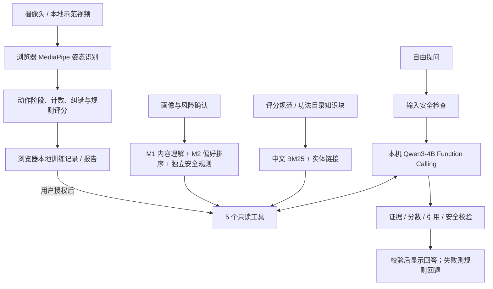

# FormPilot · 传智杯 2026

FormPilot 是面向居家规范运动与康复辅助场景的智能运动训练平台，将浏览器姿态识别、动作反馈、训练报告、个性化推荐和可追溯的 AI 问答连接起来。本项目不是医疗诊断系统，没有临床疗效验证。

本次提交版本为 **FormPilot Web V1.2.2**，来源正式 main `9aba92e22a8238fa85d2192dff105881a0af1ce1`，包含 PR #60 的动作工坊图标及开始手势修复。[独立比赛仓库](https://github.com/FormPilot-Team/FormPilot-ChuanzhiCup-2026)保持 Private，默认分支 `submission`；源码版本说明见 [版本记录](SUBMISSION_VERSION.json)，当前比赛提交可用 `git rev-parse HEAD` 核验。评审访问与待交接项见 [团队与材料交接](docs/submission/TEAM_AND_HANDOFF.md)。本轮采用本地运行，不需要公网在线 Demo。

## 产品功能

| 模块 | 实际功能 |
| --- | --- |
| 首页 | 今日摘要、继续训练、推荐入口、最近训练、首次使用说明 |
| 训练中心 | 双臂上举、侧平举、侧步开合、徒手深蹲、交替提膝、肩部环绕；课程/自由训练、摄像头计数、实时纠错、语音提示与暂停手势 |
| 功法训练 | 八段锦、太极拳、五禽戏、易筋经；标准示范视频、章节选择、整套或单式跟练、相似度与节奏、本节报告 |
| 游戏中心 | 摘苹果、林间划船、林间射箭，均有完整 React/Phaser 项目和姿态输入；独立服务运行，成绩不写入训练历史 |
| AI Coach | 用户画像、风险确认、记录授权、M1/M2 推荐与依据、固定五问；可选本机 Qwen 自由问答、工具调用和知识引用 |
| 我的 | 历史、报告、趋势、设备设置；动作工坊 V2 的动作信息 → 摄像头/本地视频采集 → 识别测试 → 保存 → 正式训练与报告；V1.2.2 包含图标及开始手势修复 |

四套功法的视频功能完整保留。视频和部分演示媒体不在 Git 中：需在有权使用这些素材的本地评审环境恢复；缺素材时页面会明确提示无法播放，**仅克隆源码不能复现全部视频**。获取及分发权限仍待负责人确认，不能将“在离线包里”视为已获得分发许可。

## 技术架构与创新



- **感知、决策与语言解释分层**：MediaPipe 在浏览器处理姿态；M1/M2 负责推荐；Qwen 只读取结构化工具结果，不读取摄像头画面。模型替换不会跳过评分或安全门禁。
- **受限 Agent**：`search_knowledge`、`get_catalog`、`recommend_training`、`read_last_training`、`compare_recent_training` 五个只读工具，最多 3 轮、5 次调用，模型漏调时按意图补调。采用 Function Calling，没有 MCP Server。
- **可核查 RAG**：由评分/功法注册表生成 220 个知识块，中文单字/双字 BM25 加实体链接，回答附 `[K#]` 原文与出处。44 个出处仍待核验；无向量检索，资料不足时明确说明。
- **训练型决策与独立安全规则**：M1 基于参考轨迹窗口特征训练；M2 发布权重使用单一 AI 标注者，属于实验性排序。冻结权重、训练脚本、标签、负结果与评测材料均保留（[训练复现](docs/submission/TRAINING_REPRODUCTION.md)），不能当作真人临床效果。
- **先校验后显示**：生成时只显示进度，模型最终回答通过安全和证据检查后才显示。拒绝改分与写历史；急性风险由规则直接响应。非数字的无依据评价仍可能漏检。

React 19 / TypeScript / Vite 构建平台和游戏，Phaser 3 绘制游戏，MediaPipe 提供姿态检测。浏览器本地保存训练数据；本机模式下提问与工具结果只到回环地址上的 Bridge/Ollama。

**自主实现与基座边界**：团队实现动作训练流程、计数/评分与报告、M1/M2 数据和训练流水线、浏览器推荐引擎、Agent 工具协议与编排、授权控制、检索、答案证据校验及回退。Qwen 的职责是理解提问、选择只读工具和组织解释，不负责识别摄像头画面、计算分数、生成训练记录或绕过安全门禁；没有对 Qwen 进行微调。

## 自研训练决策模型

发布身份为 `fp-cdm-release/1.0.0`，与 Web V1.2.2 的产品版本分别管理。M1 使用参考姿态轨迹的 **1,677 个 3 秒窗口 × 76 特征**学习部位和注意项；M2 使用画像×内容、历史×内容、报告×内容共 **111 个特征**，通过成对逻辑回归、校准和弃权在安全候选池内排序。

M2 v1.0.0 发布权重绑定 M1 v1.0 的 out-of-fold 内容表；M1 v1.1 是后续研究模型，不能写成已替换发布内容表。M2 的 **720 条标签来自单一 AI 标注者、72 个合成场景**，仍为 `ai_experimental`；负责人审阅不等于独立人工或专家验证，适配度也不是医学概率。权重、内容表、目录不匹配或推理异常时回退规则；低适配或分布外会弃权，风险暂停先于模型执行。

历史冻结测试：M1 v1.1 嵌套按功法留一 macro AUC **0.777**；M2 在 6 个族 / 18 个场景上的 NDCG@5 **0.868**、成对准确率 **0.873**。模型相对规则的 NDCG@5 差值 95% CI 为 **−0.024 至 0.122**，跨 0，不能宣称显著优于规则。来源为 [模型报告](apps/platform/docs/ai-coach-agent/decision-model/MODEL_REPORT.md)、[M1 原报告](apps/platform/scripts/decision-model/cdm/artifacts/m1-v11/fp-cdm-m1-v11.report.json)及 [冻结发布清单](apps/platform/scripts/decision-model/cdm/artifacts/integration/release-manifest.json)。这些是历史实验，不是本轮新训练或真人效果验证。

## 目录

```text
apps/platform/                    平台完整 src、server、tests、public、构建配置
  src/features/coachAgent/         推荐、可信证据、M1/M2 运行时与冻结权重
  src/features/coachLlm/           Qwen Agent 客户端、RAG、工具、安全校验
  src/features/workshop/          动作工坊及识别逻辑
  server/coachAgent/agent/        本机 Agent Bridge
  scripts/decision-model/         M1/M2 训练、标注、评测和研究记录
  scripts/competition-package/    Windows 离线包构建与启动器
apps/motion-games-lab/app/         三款游戏完整工程、e2e、独立锁文件；可选 src-tauri
docs/submission/                  版本、历史、素材、验证、发布待确认项
scripts/submission/               本地素材恢复与校验工具
```

历史实验入口 `coach-agent-lab.html`、`coach-agent-sprint.html` 因现有 E2E 引用而保留；比赛入口是平台首页。三款游戏的 Tauri 工程保留用于项目完整性，本次 Web 复现无需 Rust，不代表桌面安装包已在本轮验证。

## 环境与安装

基本环境为 Windows、Node.js **22.18+**、pnpm **12.5.1**、Python **3.12**（仅素材恢复/离线打包需要），自动化浏览器使用已安装的 Microsoft Edge。平台使用 React / TypeScript / Vite / MediaPipe，游戏使用 React / TypeScript / Vite / Phaser；精确依赖以两个应用自己的 `package.json` 与 `pnpm-lock.yaml` 为准。摄像头需浏览器授权与 `localhost` / `127.0.0.1` 安全上下文。本轮不自动下载浏览器或 Qwen。完整运行和排错步骤见 [V1.2.2 运行说明](docs/submission/RUNNING_V122.md)。

Windows 解压包主程序只需 Windows 10/11、PowerShell 5.1+ 和 Edge/Chrome，不需要 Node、pnpm、Python 或大模型；自由问答才需要可选模型环境。此前独立 V1.2.1 的安装和测试结果保留在 [历史验证](docs/submission/VALIDATION.md)，不能直接充当 V1.2.2 的通过证据。

从仓库根目录执行，两个应用各自有 `package.json`、`pnpm-lock.yaml` 和 `pnpm-workspace.yaml`：

```powershell
cd apps/platform
pnpm install --frozen-lockfile
cd ../motion-games-lab/app
pnpm install --frozen-lockfile
cd ../../..
```

不要把原开发环境的 `node_modules` 复制进来。无密钥运行是默认路径。根目录 [.env.example](.env.example) 是配置参考，不会自动加载；前端变量在构建终端设置或写入 `apps/platform/.env.local`，Bridge 变量由 Node 显式加载。M1/M2 的 ACTIVE 由 Vite `competition` 模式控制，不由 URL 参数开启。

## 启动与比赛构建

开发调试需要两个终端。从仓库根目录：

```powershell
# 终端 1：游戏，固定为平台要连接的 5181 端口
cd apps/motion-games-lab/app
pnpm dev --port 5181 --strictPort
```

```powershell
# 终端 2：平台。普通 dev 的决策模型默认为 OFF；复现参赛模式请加 --mode competition。
cd apps/platform
$env:VITE_MOTION_GAMES_URL = 'http://localhost:5181/'
pnpm dev --host 127.0.0.1 --port 4173 --strictPort --mode competition
```

打开 `http://127.0.0.1:4173/`，游戏中心应显示“体感游戏服务已连接”。分别进入摘苹果、林间划船、林间射箭；也可直接打开 `http://localhost:5181/` 从大厅进入三款游戏，不需要分别启动三个服务。允许摄像头后才能真人训练；`localhost` 指的是正在使用浏览器的那台电脑。

生产比赛构建：

```powershell
cd apps/motion-games-lab/app
pnpm build
pnpm preview
```

```powershell
cd apps/platform
$env:VITE_MOTION_GAMES_URL = 'http://localhost:5181/'
pnpm competition:build
pnpm competition:preview
```

平台为 `http://localhost:4175/`，游戏为 `http://localhost:5181/`。保持两个终端打开。普通 `pnpm build` 可用于常规部署，但不等于 M1/M2 ACTIVE 的比赛构建。

## 素材与离线包

授权未确认的四套功法视频/海报及六个热身视频被整个历史过滤排除；本地验证时作为 `.gitignore` 忽略的素材覆盖层恢复。拿到有权使用、且媒体匹配清单的解压包后，可以从仓库根目录运行（V1.2.2 沿用此媒体清单）：

```powershell
python scripts/submission/restore_media.py --source-package '<已授权的解压包根目录>'
python scripts/submission/restore_media.py --check
```

恢复程序按明确清单和 SHA-256 检查，不联网，不覆盖内容不同的现有文件。取得使用权限后也可以替换为独立授权的素材，但应重新记录校验值并完成视频与参考轨迹一致性验收。

```powershell
# 在 apps/platform 内；须先安装两个应用的依赖并恢复素材。
python -I -B scripts/competition-package/build_package.py --out '<全新的输出目录>' --version 1.2.2
```

上述脚本重建两端并产生初始包。还必须回到仓库根目录完成 V1.2.2 封包：

```powershell
python scripts/submission/finalize_v122_package.py --source-root . --package '<全新的输出目录>/FormPilot-Web-V1.2.2'
```

封包步骤修正包内版本文案、收集已安装依赖的 LICENSE/NOTICE、写 `FILE_MANIFEST.json` 和逐文件 SHA-256，并重新生成最终 ZIP 与 `.zip.sha256`；不能省略并使用初始 ZIP。新包必须重新解压、通过包内 `start-formpilot.cmd` 启动并验收，**不能复用 V1.2.1 的 SHA 或将旧包改名**。本轮包、校验及内部 Release 见 [封版验证记录](docs/submission/V122_FINAL_CHECKS.md)。

## 可选：本机 Qwen 自由问答

无需模型即可使用训练、四套功法、动作工坊、报告、三款游戏、固定五问和 M1/M2 推荐。没有 Bridge 时自由提问显示“本地 AI 模型未连接”，输入框禁用，是设计内的降级。

完整自由问答需要自行准备 **Ollama 0.40.13**、`qwen3:4b-instruct-2507-q4_K_M`，模型 digest 必须是 `0edcdef34593eac1aa2be9c7d06c432dcf81945adca5eca2f27662c18f168ba0`。模型约 2.5 GB，不在仓库；参考 [Ollama 模型页](https://ollama.com/library/qwen3) 和 [Qwen 模型说明](https://huggingface.co/Qwen/Qwen3-4B-Instruct-2507)。决定下载时使用 `ollama pull qwen3:4b-instruct-2507-q4_K_M`，下载后核对 digest，不以同名标签代替校验。本轮未下载模型或重跑真实推理。

在已有该环境的电脑上，先在独立终端启动本机 Ollama（示例端口 11441）：

```powershell
$env:OLLAMA_HOST = '127.0.0.1:11441'
ollama serve
```

再在 `apps/platform` 的另一个终端执行：

```powershell
$env:FP_AGENT_ENABLED = 'true'
$env:FP_AGENT_PORT = '4321'
$env:FP_AGENT_OLLAMA_PORT = '11441'
$env:FP_AGENT_MODEL = 'qwen3:4b-instruct-2507-q4_K_M'
$env:FP_AGENT_ORIGINS = 'http://127.0.0.1:4173,http://localhost:4175'
$env:FP_AGENT_PRELOAD = 'false'
pnpm agent:bridge
```

`pnpm agent:bridge` 只读取当前进程环境，不自动加载 `.env`。若将对应 Bridge 配置保存为 `apps/platform/.env.agent.local`，应在平台目录显式使用 `node --env-file=.env.agent.local server/coachAgent/agent/index.ts`；不要仅复制根模板就认为配置已生效。根模板默认 `FP_AGENT_ENABLED=false`，需由环境管理者明确启用。Vite 前端配置与 Bridge 进程配置分别加载。

模型读取会消耗内存/显存，首次冷启动需等待。Bridge 固定本机监听，拒绝非白名单 Origin。打开 AI Coach → 训练问答；查看上次训练或近期进步还需在对话框单独授权。模型完整条件见 [Agent 环境模板](apps/platform/docs/ai-coach-agent/agent.env.example)。

Windows 包可使用 `ai-coach-local\start-ai-coach-local.cmd` 检查已有环境并启动 Bridge；非默认 Ollama 端口用其 `.ps1 -OllamaPort 11441`。启动器不安装或下载模型。模型标签相同但 digest 不符时，Bridge 不会把它当作已验证模型。

## 测试与已知限制

在 **两个应用目录分别**运行：

```powershell
pnpm typecheck
pnpm lint
pnpm test
pnpm test:e2e
```

平台比赛构建运行后，可运行 `pnpm exec playwright test -c playwright.web-v1-visual.config.ts`。完整素材和两端服务运行后，可运行 `pnpm exec playwright test -c playwright.package-smoke.config.ts`，检查四套视频实际播放及平台游戏联通。若测试解压后的离线包，进入游戏目录运行 `pnpm exec playwright test -c playwright.submission.config.ts`，默认连接该包的 `http://localhost:5181`；保留原 15 项完整游戏测试，不启动另一份游戏服务。`tests/llm-eval`、`playwright.llm-demo.config.ts` 是显式真实模型评测，不属于默认单元/E2E 命令。

V1.2.1 交接中可追溯的历史测试成绩：单元/集成 **2220/2220**；竞赛视觉/ACTIVE **57/57**；解压包冒烟 **7/7**；全量 E2E **204 通过、2 失败、1 跳过**，失败用例单独复测 6/6。真实 Qwen Agent run8 **27/27**；RAG run4 20 题事实召回 **0.35 → 0.95**，无依据句子 **92.3% → 7.4%**。[原始评测汇总及来源 SHA-256](docs/submission/HISTORICAL_MODEL_RESULTS.json)随仓库保留。此前独立仓库另有一轮 V1.2.1 验证，单独列在 [VALIDATION.md](docs/submission/VALIDATION.md)；两轮旧结果均不能冒充本次 V1.2.2 重跑。

**V1.2.2 本轮安装、构建、回归、解压运行及 CI 结果**单独记录在 [封版验证记录](docs/submission/V122_FINAL_CHECKS.md)及 [机器可读汇总](docs/submission/v122-validation-results.json)，不使用上面的历史成绩冒充本次结果。

自动化包含合成姿态、测试夹具及假上游，不能代替真人摄像头训练、真人记录问答或评委电脑验证。44 条出处、素材授权、非数字幻觉和模型偶发漏引文仍是已知限制；M2 尚无独立人工/专家标签，多设备 SHADOW 覆盖不足。本届没有公网在线演示，不声称具备语音输入、大模型视觉、长期记忆、微调或临床认证。

## 开发历史、团队与许可

保留真实作者、时间和提交说明的路径过滤历史：V1.2.1 时基线主线 80 条，另保留 `history/web-v12-development` 分支，共 131 条历史提交；本轮 PR #60 来源同步及提交准备另作当前真实提交，不回填时间。路径变化导致 SHA 改变，原映射见 [commit-map.txt](docs/submission/commit-map.txt)，重要任务见[开发时间线](docs/submission/DEVELOPMENT_HISTORY.md)，本轮来源见[提交说明](docs/submission/PROVENANCE.md)。签名不随重写保留，不声称过滤提交仍具有原签名。

官方要求“保留完整的 Git 提交历史”。本仓库只保留作品路径，并非原私有 Monorepo 的全部历史，是否被赛事接受仍需组委会/负责人确认；本地另存未过滤审计副本，不将其当作公开附件。保留的历史包含个人邮箱、内部路径与已识别的测试假 Key，在完成公开审查前不能直接推送 Public。

| 团队信息 | 当前状态 |
| --- | --- |
| 报名队伍名称、学校、院系与专业背景 | **待负责人按报名资料填写** |
| 正式参赛成员姓名、GitHub 身份与分工 | **待负责人确认**；Git 作者列表不能替代报名名单 |
| 指导老师姓名、单位与职称 | **待负责人填写** |
| 项目责任人与最终验收 | GitHub `KiyOm1Lykke` |
| 产品设计、技术文档与真人体验验收 | Wang，GitHub `wang-linn-dw`（#57）；正式文件等待交接 |
| 最终 V5 视频 | CC；最终字幕修复后交接，此职责不自动代表报名成员身份 |

Wang 的产品设计 Word/PDF、技术方案 Word/最终 PDF、README 审阅和全功能验收记录均保留明确交接项；本轮不覆盖其编辑源文件。最终文件应与 Web V1.2.2、正式主线及比赛仓库最终 SHA 对齐，见 [团队与材料交接](docs/submission/TEAM_AND_HANDOFF.md)。

第三方组件和素材的版权归各自权利人所有。MediaPipe 与 Qwen 为 Apache-2.0；React、Vite、Phaser 等依赖的许可见各包 LICENSE。当前未给团队原创源码自行新增开放许可，Private 仓库或公开可见均不等于已获第三方媒体再分发权。评审账号需负责人核实后授予最小读取权限，并实际验证访问；未经确认不改 Public、不代交官网。
