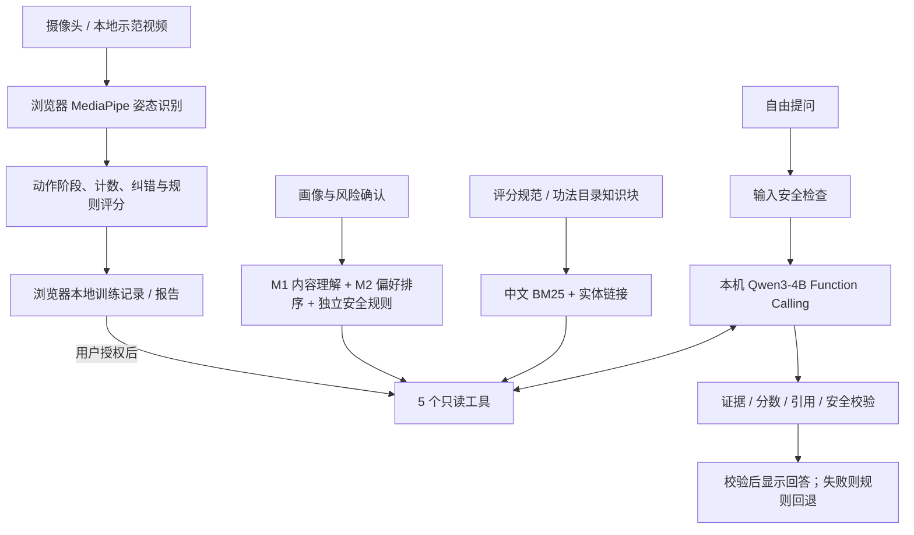

# FormPilot · 传智杯 2026

FormPilot 是面向居家规范运动与康复辅助场景的智能运动训练平台，将浏览器姿态识别、动作反馈、训练报告、个性化推荐和可追溯的 AI 问答连接起来。本项目不是医疗诊断系统，没有临床疗效验证。

本仓库是 **Web V1.2.1 的本地独立提交候选**。尚未发布 GitHub/Gitee 仓库，未部署公网演示。正式参赛源码基线为 `f6e081202d2f5f7652f11198af2542d755d88b3a`。代码、素材权限、历史和文档版本的详细说明见 [提交说明](docs/submission/PROVENANCE.md)、[素材与许可](docs/submission/ASSETS_AND_LICENSES.md)及 [版本一致性](docs/submission/VERSION_CONSISTENCY.md)。

## 产品功能

| 模块 | 实际功能 |
| --- | --- |
| 首页 | 今日摘要、继续训练、推荐入口、最近训练、首次使用说明 |
| 训练中心 | 双臂上举、侧平举、侧步开合、徒手深蹲、交替提膝、肩部环绕；课程/自由训练、摄像头计数、实时纠错、语音提示与暂停手势 |
| 功法训练 | 八段锦、太极拳、五禽戏、易筋经；标准示范视频、章节选择、整套或单式跟练、相似度与节奏、本节报告 |
| 游戏中心 | 摘苹果、林间划船、林间射箭，均有完整 React/Phaser 项目和姿态输入；独立服务运行，成绩不写入训练历史 |
| AI Coach | 用户画像、风险确认、记录授权、M1/M2 推荐与依据、固定五问；可选本机 Qwen 自由问答、工具调用和知识引用 |
| 我的 | 历史、报告、趋势、设备设置；动作工坊 V2 的动作信息 → 摄像头/本地视频采集 → 识别测试 → 保存 → 训练闭环 |

四套功法的视频功能完整保留。视频和部分演示媒体不在 Git 中：需在有权使用这些素材的本地评审环境恢复；缺素材时页面会明确提示无法播放，**仅克隆源码不能复现全部视频**。获取及分发权限仍待负责人确认，不能将“在离线包里”视为已获得分发许可。

## 技术架构与创新



- **感知、决策与语言解释分层**：MediaPipe 在浏览器处理姿态；M1/M2 负责推荐；Qwen 只读取结构化工具结果，不读取摄像头画面。模型替换不会跳过评分或安全门禁。
- **受限 Agent**：`search_knowledge`、`get_catalog`、`recommend_training`、`read_last_training`、`compare_recent_training` 五个只读工具，最多 3 轮、5 次调用，模型漏调时按意图补调。采用 Function Calling，没有 MCP Server。
- **可核查 RAG**：由评分/功法注册表生成 220 个知识块，中文单字/双字 BM25 加实体链接，回答附 `[K#]` 原文与出处。44 个出处仍待核验；无向量检索，资料不足时明确说明。
- **训练型决策与独立安全规则**：M1 基于参考轨迹窗口特征训练；M2 发布权重使用单一 AI 标注者，属于实验性排序。冻结权重、训练脚本、标签、负结果与评测材料均保留（[训练复现](docs/submission/TRAINING_REPRODUCTION.md)），不能当作真人临床效果。
- **先校验后显示**：生成时只显示进度，模型最终回答通过安全和证据检查后才显示。拒绝改分与写历史；急性风险由规则直接响应。非数字的无依据评价仍可能漏检。

React 19 / TypeScript / Vite 构建平台和游戏，Phaser 3 绘制游戏，MediaPipe 提供姿态检测。浏览器本地保存训练数据；本机模式下提问与工具结果只到回环地址上的 Bridge/Ollama。

## 目录

```text
apps/platform/                    平台完整 src、server、tests、public、构建配置
  src/features/coachAgent/         推荐、可信证据、M1/M2 运行时与冻结权重
  src/features/coachLlm/           Qwen Agent 客户端、RAG、工具、安全校验
  src/features/workshop/          动作工坊及识别逻辑
  server/coachAgent/agent/        本机 Agent Bridge
  scripts/decision-model/         M1/M2 训练、标注、评测和研究记录
  scripts/competition-package/    Windows 离线包构建与启动器
apps/motion-games-lab/app/         三款游戏完整工程、e2e、独立锁文件；可选 src-tauri
docs/submission/                  版本、历史、素材、验证、发布待确认项
scripts/submission/               本地素材恢复与校验工具
```

历史实验入口 `coach-agent-lab.html`、`coach-agent-sprint.html` 因现有 E2E 引用而保留；比赛入口是平台首页。三款游戏的 Tauri 工程保留用于项目完整性，本次 Web 复现无需 Rust，不代表桌面安装包已在本轮验证。

## 环境与安装

本轮验证环境及实际结果见 [VALIDATION.md](docs/submission/VALIDATION.md)。基本环境为 Windows、Node.js **22.18+**（本轮使用 24.12.0）、pnpm **12.5.1**、Python **3.12**（仅素材恢复/离线打包需要），自动化浏览器使用已安装的 Microsoft Edge。测试不自动下载浏览器或 Qwen。

从仓库根目录执行，两个应用各自有 `package.json`、`pnpm-lock.yaml` 和 `pnpm-workspace.yaml`：

```powershell
cd apps/platform
pnpm install --frozen-lockfile
cd ../motion-games-lab/app
pnpm install --frozen-lockfile
cd ../../..
```

不要把原开发环境的 `node_modules` 复制进来。无密钥运行是默认路径。根目录 [.env.example](.env.example) 是配置参考，不会自动加载；前端变量在构建终端设置或写入 `apps/platform/.env.local`，Bridge 变量由 Node 显式加载。M1/M2 的 ACTIVE 由 Vite `competition` 模式控制，不由 URL 参数开启。

## 启动与比赛构建

开发调试需要两个终端。从仓库根目录：

```powershell
# 终端 1：游戏，固定为平台要连接的 5181 端口
cd apps/motion-games-lab/app
pnpm dev --port 5181 --strictPort
```

```powershell
# 终端 2：平台。普通 dev 的决策模型默认为 OFF；复现参赛模式请加 --mode competition。
cd apps/platform
$env:VITE_MOTION_GAMES_URL = 'http://localhost:5181/'
pnpm dev --host 127.0.0.1 --port 4173 --strictPort --mode competition
```

打开 `http://127.0.0.1:4173/`，游戏中心应显示“体感游戏服务已连接”。允许摄像头后才能真人训练；`localhost` 指的是正在使用浏览器的那台电脑。

生产比赛构建：

```powershell
cd apps/motion-games-lab/app
pnpm build
pnpm preview
```

```powershell
cd apps/platform
$env:VITE_MOTION_GAMES_URL = 'http://localhost:5181/'
pnpm competition:build
pnpm competition:preview
```

平台为 `http://localhost:4175/`，游戏为 `http://localhost:5181/`。保持两个终端打开。普通 `pnpm build` 可用于常规部署，但不等于 M1/M2 ACTIVE 的比赛构建。

## 素材与离线包

授权未确认的四套功法视频/海报及六个热身视频被整个历史过滤排除；本地验证时作为 `.gitignore` 忽略的素材覆盖层恢复。拿到有权使用的 **V1.2.1 解压包**后，可以从仓库根目录运行：

```powershell
python scripts/submission/restore_media.py --source-package '<解压后的 FormPilot-Web-V1.2.1 目录>'
python scripts/submission/restore_media.py --check
```

恢复程序按明确清单和 SHA-256 检查，不联网，不覆盖内容不同的现有文件。取得使用权限后也可以替换为独立授权的素材，但应重新记录校验值并完成视频与参考轨迹一致性验收。

```powershell
# 在 apps/platform 内；须先安装两个应用的依赖并恢复素材。
python -I -B scripts/competition-package/build_package.py --out '<新的输出目录>' --version 1.2.1
```

脚本会重新构建两端、写 `VERSION.txt` 和逐文件 SHA-256，再生成 ZIP。新包的提交和生成时间不同，**不能复用旧包 SHA**。既有官方演示候选包 SHA-256 为 `5831b223d679f1346e27ad22075ddff86770663fe374e541b1fcbd78a7ea5429`，它记录旧构建提交 `8e00101`；详见版本一致性表。

## 可选：本机 Qwen 自由问答

无需模型即可使用训练、四套功法、动作工坊、报告、三款游戏、固定五问和 M1/M2 推荐。没有 Bridge 时自由提问显示“本地 AI 模型未连接”，输入框禁用，是设计内的降级。

完整自由问答需要自行准备 **Ollama 0.40.13**、`qwen3:4b-instruct-2507-q4_K_M`，模型 digest 必须是 `0edcdef34593eac1aa2be9c7d06c432dcf81945adca5eca2f27662c18f168ba0`。模型约 2.5 GB，不在仓库；参考 [Ollama 模型页](https://ollama.com/library/qwen3) 和 [Qwen 模型说明](https://huggingface.co/Qwen/Qwen3-4B-Instruct-2507)。决定下载时使用 `ollama pull qwen3:4b-instruct-2507-q4_K_M`，下载后核对 digest，不以同名标签代替校验。本轮未下载模型或重跑真实推理。

在已有该环境的电脑上，先启动本机 Ollama（示例端口 11441），再在 `apps/platform` 的另一个终端执行：

```powershell
$env:FP_AGENT_ENABLED = 'true'
$env:FP_AGENT_OLLAMA_PORT = '11441'
$env:FP_AGENT_ORIGINS = 'http://127.0.0.1:4173,http://localhost:4175'
$env:FP_AGENT_PRELOAD = 'false'
pnpm agent:bridge
```

模型读取会消耗内存/显存，首次冷启动需等待。Bridge 固定本机监听，拒绝非白名单 Origin。打开 AI Coach → 训练问答；查看上次训练或近期进步还需在对话框单独授权。模型完整条件见 [Agent 环境模板](apps/platform/docs/ai-coach-agent/agent.env.example)。

## 测试与已知限制

在 **两个应用目录分别**运行：

```powershell
pnpm typecheck
pnpm lint
pnpm test
pnpm test:e2e
```

平台比赛构建运行后，可运行 `pnpm exec playwright test -c playwright.web-v1-visual.config.ts`。完整素材和两端服务运行后，可运行 `pnpm exec playwright test -c playwright.package-smoke.config.ts`，检查四套视频实际播放及平台游戏联通。`tests/llm-eval`、`playwright.llm-demo.config.ts` 是显式真实模型评测，不属于默认单元/E2E 命令。

V1.2.1 交接中可追溯的历史测试成绩：单元/集成 **2220/2220**；竞赛视觉/ACTIVE **57/57**；解压包冒烟 **7/7**；全量 E2E **204 通过、2 失败、1 跳过**，失败用例单独复测 6/6。真实 Qwen Agent run8 **27/27**；RAG run4 20 题事实召回 **0.35 → 0.95**，无依据句子 **92.3% → 7.4%**。这些是原版本报告，不能冒充本次重跑结果；本次独立仓库的结果单独列在 [VALIDATION.md](docs/submission/VALIDATION.md)。

自动化包含合成姿态、测试夹具及假上游，不能代替真人摄像头训练、真人记录问答或评委电脑验证。44 条出处、素材授权、非数字幻觉和模型偶发漏引文仍是已知限制。本届没有公网在线演示，不声称具备语音输入、大模型视觉、长期记忆、微调或临床认证。

## 开发历史、团队与许可

保留真实作者、时间和提交说明的路径过滤历史：基线主线 80 条，另保留 `history/web-v12-development` 分支，合计 131 条历史提交；提交准备改动另作当前真实提交。路径变化导致 SHA 改变，映射见 [commit-map.txt](docs/submission/commit-map.txt)。签名不随重写保留，不声称过滤提交仍具有原签名。

官方要求“保留完整的 Git 提交历史”。本仓库只保留作品路径，并非原私有 Monorepo 的全部历史，是否被赛事接受仍需组委会/负责人确认；本地另存未过滤审计副本，不将其当作公开附件。保留的历史包含个人邮箱、内部路径与已识别的测试假 Key，在完成公开审查前不能直接推送 Public。

项目维护与最终验收：GitHub `KiyOm1Lykke`。文档与真人体验验收任务负责人：`wang-linn-dw`（#57）。**报名队伍名称、学校、参赛成员名单与分工由负责人确认后补入，Git 作者列表不能替代报名名单。**

第三方组件和素材的版权归各自权利人所有。MediaPipe 与 Qwen 为 Apache-2.0；React、Vite、Phaser 等依赖的许可见各包 LICENSE。当前未给团队原创源码自行新增开放许可，仓库公开可见也不等于已获第三方媒体再分发权。最终提交地址待负责人确认并创建。
