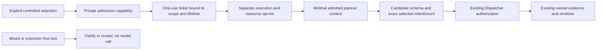

# Trusted input and pinned Qwen3 4B: offline integration

This document records a default-off, offline trusted-input research interface. It is separate from the current Web V1.2 Agent documented in `ai-coach-agent/WEB_V12_LLM_AGENT.md`. The interface adds no page or model launcher. Its historical baseline predates PR #36's privacy projection changes. That PR's frozen audit remains **59/80 AI-draft semantic fidelity, 0/47 declared synthetic-sensitive leaks, Gold 0/2**. Those values describe its frozen output, not main's older projector or these new tests.

## Data flow and public contract

The existing route is `run(rawQuestion) → localProvider projection → local bridge → planner → Dispatcher → owned evidence → answer`. It remains unchanged for existing callers and is not automatically replaced in the Web lab.

The new optional route is:

`createQuestionAdmission` is a pure in-memory contract. Its host capture/update methods must remain private to a trusted application composition layer. They are not endpoints, window globals, JSON authentication or proof against compromised application code. Input object names and TypeScript brands confer no trust. Plain descriptors are snapshotted; getters, symbols, extra fields, custom prototypes, malformed types and JSON strings are rejected. No JSON-string ingestion endpoint exists here, so duplicate-key JSON is rejected wholesale rather than parsed.

`createTrustedCoach` composes admission with an existing local `intent-v2` provider and existing Dispatcher. It exposes `prepareSelection`, `prepareQuestion`, `clarify`, `execute`, `cancel`, and `dispose`. `enabled`, `consent`, `inferenceEnabled`, and `resourcesConfirmed` all default off. The underlying provider must independently be enabled/consented; this layer never changes that setting. Construction/preparation have no transport or reader calls.

Only an explicit user-selected bounded request can produce a ticket:

| Selection | Necessary text | Planner projection |
| --- | --- | --- |
| `{kind:'controlled',intent:'explain',subject:'squat'}` | `解释这次深蹲评分。` | question-scope, only warmup scope |
| `{kind:'controlled',intent:'routine',subject:'baduanjin'}` | `解释这次八段锦跟练表现。` | question-scope, only routine scope |
| `{kind:'controlled',intent:'history',subject:'squat',previousCount:N}` | `比较这次深蹲评分和之前历史，只看N次。` (local only) | structured, mode=history, historyLimit=N |

An optional `question` field on a controlled selection must exactly equal that selection's necessary text. Appended identities, paths, instructions, normalization changes or unrelated text cause clarification; they are never silently trimmed or substituted. These are product templates and structured options, not answers copied from the frozen 80 examples. `previousCount` is 1–64 **previous records excluding the current record**, bounded by application scope. It is not `recent N minus one`, an authorization grant or automatic count clamping.

History uses main's existing structured protocol because main's projector does not retain Arabic counts. No PR #36 vocabulary/count patch is copied. The local explanation text retains N, while the model receives only mode, scope and remainingCalls. A candidate must match the selected intent and exact history count, or decline without reads. This measures controlled structured planning, not natural-language count recovery. The local provider's new `nextAdmitted` method narrows its configured session scope and history bound; it never expands them.

`prepareQuestion({kind:'question-only',text})` never directly admits arbitrary free text. Loss, controls, paths, mixed identities, oversized text or unsupported representation require clarification; even a lossless projection returns `review_required`. A field named question, no mask, idempotence or user confirmation is not a general privacy guarantee. Normal text transmission is limited to the explicit selected-template contract above. Future free-text admission needs a separate reviewed policy and must not copy this implementation into a permissive keyword detector.

Identity, account, file path and record references stay in the application's private sidecar. They are not parameters to the new input methods or planner wire. Provider session IDs and Dispatcher authorization are independent trusted configuration. Rebind a fresh adapter when record selection, authorization, policy or approval changes; dispose the old one first. Never derive a controlled selection by cutting the tail from a mixed identity/path string.

## Cancellation, expiry and execution

Each submission supersedes old captures/tickets/leases. Unknown mixed input is never inspected or retained. Revocation clears capabilities before notifying abort observers. Replays, clones, cross-instance capabilities and stale versions are rejected. Consumption and request-budget debit are synchronous and single-use; no refund or automatic retry after failure. An active lease has an abort timer tied to the original capture deadline, including while a slow Dispatcher read is pending. Cancellation, new input, expiry or disposal rejects late model results. Completion of an old request cannot cancel a newer submission.

The original orchestrator, Reader and Dispatcher still enforce storage permissions, owned receipts, evidence provenance, budgets and read-only operations. Only a minimal wire is passed to `nextAdmitted`; raw observations and sidecars are excluded. Model candidates cannot choose the trusted record ID or change selected intent/count. The private Dispatcher object is reused with its existing authorization, not reconstructed from model output.

## Qwen identity and 8192 budget

- Model: `qwen3:4b-instruct-2507-q4_K_M`.
- Official manifest digest: `sha256:0edcdef34593eac1aa2be9c7d06c432dcf81945adca5eca2f27662c18f168ba0`.
- Existing portable runtime: Ollama `0.40.13`. For this new tag, session exchange and every step verify exact runtime version, tag/digest, qwen3 and Q4_K_M metadata before chat. No pull/install/load action is part of verification.
- Model files remain outside Git in the local Ollama model directory. Neither the legacy compatibility-manifest hash nor weight-blob hash is the Planner digest.

`reserveLocalContext` charges the entire serialized Ollama request, including user context, system prompt, tools/schema and other envelope text, plus a 512-token template allowance and reserved output. The sum must be ≤8192 before metadata/chat dispatch for a step; otherwise the request is rejected without truncation. Actual returned prompt/output usage is independently validated, including combined ≤8192, before any candidate is accepted. All three planning protocols use `num_ctx=8192`; no fallback protocol/model, silent reduction or retry is introduced.

UTF-8 byte count plus 512 is a conservative accounting proxy, **not a verified tokenizer or runtime-template bound**. The offline implementation closes the missing input-plus-output check, but does not certify a fully packed 8192-token real prompt. Template overhead, actual tokenizer behavior and any runtime truncation require separate real-model measurement. The research interface does not itself provide a UI or launcher; its programmatic port/config options must be set by the calling harness.

## Host display contract

The restricted research interface requires these host states:

- `clarification_required`: fixed prompt to re-enter only the training question, with no name/account/contact/path. Offer a separate explicit bounded request selection and independently selected training record. Never echo an inferred slice or auto-submit a candidate.
- `review_required`: explain that this wording cannot yet be safely submitted; allow explicit supported selection or cancel. Do not implement a “send anyway” button.
- `disabled`/`denied`: fixed status without raw text, private fields or exception details.
- `ready`: opaque in-memory ticket, not a model authorization or persisted JSON token. Separate informed execution authorization remains required.
- New input, record/consent change, navigation or cancel must cancel/dispose the prior request. Do not log raw mixed input, tickets, identity sidecars or hashes of private text in telemetry/URLs.

Real UI/IPC provenance and interaction acceptance were not tested by this offline research.

## Historical statistics and validation limits

Keep four separate groups: PR #36 frozen80 (59/80, 0/47), main legacy projector characterization, new admission/calling tests, and fake-HTTP Qwen protocol tests. Refused original inputs are not semantic fixes. Synthetic fake HTTP has no Qwen load and cannot measure model quality, performance or human review.

On main `677731894b13c3d1dde66c54397ece0b7cfcd93a`, the unchanged legacy projector still retains two declared synthetic-sensitive spans (QS-071 and QS-072: **2/47**); only 45/80 outputs equal PR #36's frozen output. The new admission route admits none of those 80 raw free-text inputs and clarifies all 80 mixed submissions. This protects the new restricted entrypoint only. This offline result does not establish that every existing caller or UI was repaired.

Gold packages remain two independent blank reviewer packages; actual review is 0/2. AI tests never sign or fill their decisions. The original semantic threshold and human-review requirement were not satisfied.

Real-model validation remains separate from these offline tests. A reproducible trial must record committed source/configuration, dataset and model digest; measure memory, context/token accounting, timeout and OOM behavior; and verify loopback isolation and cancellation. The original planned resource snapshot was RAM ≥10 GiB, VRAM ≥6 GiB and ≥12 GiB free model storage; these were test preconditions, not measured minimum hardware requirements. No real-model quality, performance or human-review conclusion follows from the fake-HTTP tests.
